<p align="center">
    
</p>

<h1 align="center">chamberu</h1>

<p align="center">
    <b>Self-hosted, trigger-driven AI agents with durable runs, built on the Vercel AI SDK.</b><br>
    You write the agent with the AI SDK. chamberu queues its runs, checkpoints every step,<br>
    pauses for approvals and resumes interrupted runs, in your own Node process and database.
</p>

<p align="center">
    <a href="https://www.npmjs.com/package/@chamberu/core"></a>
    <a href="https://github.com/chamberu/chamberu/actions/workflows/ci.yml"></a>
    <a href="https://github.com/chamberu/chamberu/blob/master/LICENSE"></a>
</p>

<p align="center">
    <a href="#why-chamberu"><b>Why chamberu?</b></a>
    ·
    <a href="#packages">Packages</a>
    ·
    <a href="#quick-start">Quick start</a>
    ·
    <a href="#development">Development</a>
</p>

---

> chamberu is at an early stage. `@chamberu/core`, `@chamberu/test-kit` and `@chamberu/store-typeorm` exist; the HTTP, scheduler, sandbox, GitHub and dashboard packages are planned.

## Why chamberu?

The AI SDK runs a model and its tool loop, and stops there. An agent that reacts to webhooks and schedules also needs a queue, a way to survive a restart halfway through a run, a guard against posting the same comment twice after a retry, and a way to wait a day for a human to approve a call. That usually means a hosted orchestrator, or a lot of glue code.

chamberu is that layer as a library, with no orchestrator server and no Redis:

| Concern | AI SDK on its own | chamberu |
|---|---|---|
| **Intake** | You call `generateText` from your handler | `dispatch()` stores a `queued` run; an `idempotencyKey` turns a redelivery into the existing run |
| **Concurrency** | Two webhooks for the same issue race each other | One run at a time per `concurrencyKey`, enforced through the store across replicas |
| **Durability** | A crash loses the conversation | A checkpoint after every step; a recovered run continues from the latest one |
| **Side effects** | A retried tool call posts again | `defineEffectTool()` records each result per effect key and can check the remote system before acting |
| **Approvals** | You build the pause, the storage and the callback | The run waits in `waiting` with a signed resume token; `resume(token, decision)` continues it |
| **Limits** | `stopWhen` per call | `maxSteps`, `maxTokens` and `timeoutMs` per run, settled as `completed` or `failed` |
| **Shutdown** | Runs die with the process | `drain()` waits for in-flight runs, then marks the rest `interrupted` for another replica |

Models, messages and tools stay AI SDK types: `defineAgent()` takes a `LanguageModel`, your tool factory returns tools built with `tool()`, and nothing is wrapped in a chamberu type.

<p align="center">
    
</p>

A run moves from `queued` to `running` and settles `completed`, `failed` or `cancelled`. An approval parks it in `waiting` until `resume()` requeues it; `drain()` or a crash leaves it `interrupted` (or with a lapsed claim) until `recover()` requeues it. Every requeued run continues from its latest checkpoint.

## Packages

| Package | Version | Description |
|---|---|---|
| [`@chamberu/core`](./packages/core) | [](https://www.npmjs.com/package/@chamberu/core) | Agents, triggers, the run engine, checkpoints, effect tools, approvals, agent state and the in-memory store |
| [`@chamberu/test-kit`](./packages/test-kit) | [](https://www.npmjs.com/package/@chamberu/test-kit) | `ControllableClock` and the store contract suite every `IStore` implementation must pass |
| [`@chamberu/store-typeorm`](./packages/store-typeorm) | [](https://www.npmjs.com/package/@chamberu/store-typeorm) | TypeORM store (PostgreSQL): durable runs, leases and agent state across replicas |

## Quick start

```bash
npm install @chamberu/core ai @ai-sdk/anthropic zod --save
```

ESM only, Node.js `>=22`. `ai@^7` is a peer dependency; use the provider package of your model.

```typescript
import { anthropic } from '@ai-sdk/anthropic';
import { z } from 'zod';
import {
    MemoryStore,
    RunEngine,
    defineAgent,
    defineEffectTool,
    manual,
} from '@chamberu/core';

const triage = defineAgent({
    name: 'triage',
    model: anthropic('claude-sonnet-5-5'),
    instructions: 'Label the issue in the trigger payload as bug, feature or question.',
    triggers: [manual()],
    tools: () => ({
        // recorded per (run, tool, input): a recovered run reuses the result
        addLabel: defineEffectTool({
            description: 'Adds a label to the issue.',
            inputSchema: z.object({ label: z.enum(['bug', 'feature', 'question']) }),
            execute: async ({ label }) => ({ added: label }),
        }),
    }),
});

const engine = new RunEngine({
    store: new MemoryStore(),
    agents: [triage],
    resumeSecret: process.env.RESUME_SECRET ?? 'change-me',
});
await engine.start();

const { runId } = await engine.dispatch({
    agent: 'triage',
    trigger: 'manual',
    source: 'manual',
    payload: { title: 'App crashes on start' },
});

await engine.idle();
console.log(await engine.getRun(runId)); // status: 'completed', output: the model's last answer

await engine.drain();
```

`MemoryStore` keeps everything in process memory; it is for development and tests. Effect tools, approvals, agent state, budgets and the full option reference are in the [`@chamberu/core` README](./packages/core#readme).

## Development

```bash
npm install
npm run build
npm run test
npm run typecheck
npm run lint
```

The packages live in `packages/*`, built with tsdown and orchestrated by nx. Commits follow Conventional Commits; release-please versions each package.

## Contributing

Before starting to work on a pull request, it is important to review the guidelines for
[contributing](./CONTRIBUTING.md) and the [code of conduct](./CODE_OF_CONDUCT.md).
These guidelines will help to ensure that contributions are made effectively and are accepted.

## License

Made with 💚

Published under [Apache License 2.0](./LICENSE).
